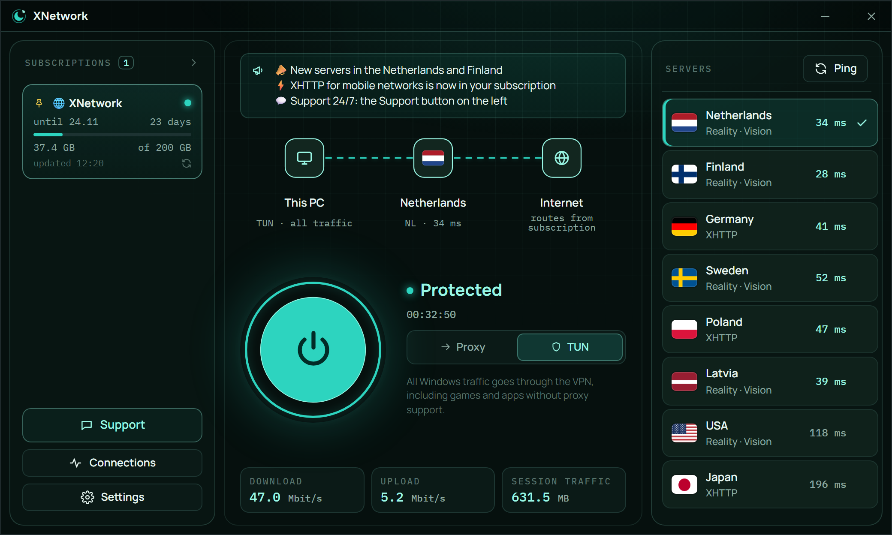
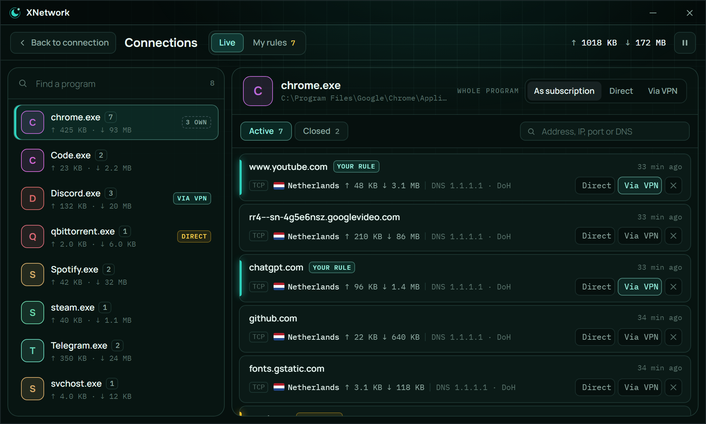
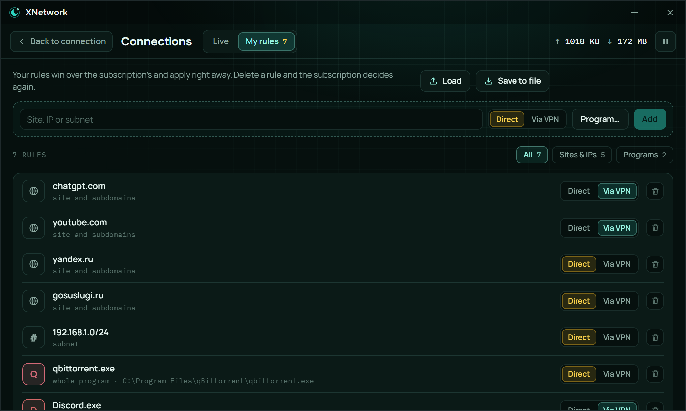
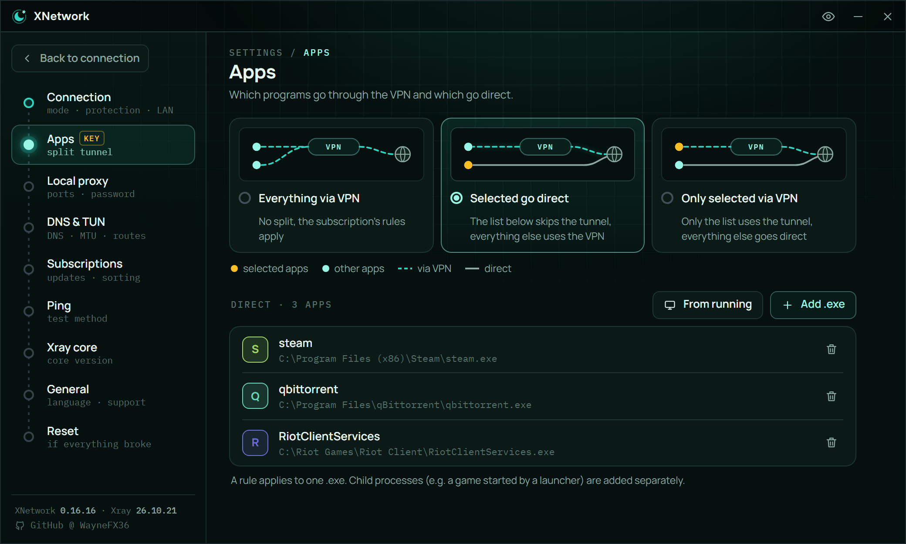
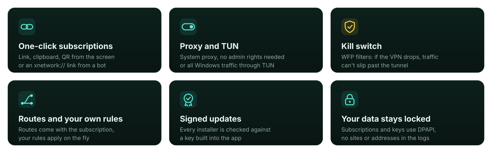
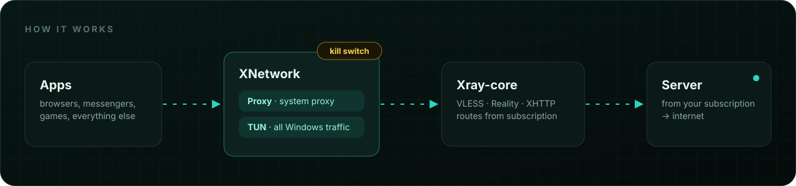

<a href="README.md">Русский</a> · <b>English</b>

  

  

  

 

<a href="https://github.com/WayneFX36/XNetwork-Client/releases">All versions</a> · <a href="#installation">Installation</a> · <a href="#modes">Modes</a> · <a href="#faq">FAQ</a>

 

**XNetwork** is a lightweight VPN client for Windows. Paste your subscription link and press Connect: servers and routes are pulled in automatically, and the client takes care of the rest. Under the hood it's only [Xray-core](https://github.com/XTLS/Xray-core), with no extra cores or settings to wade through.

 

 
<b>Main screen</b> · subscription, servers and one-click connect
  

 
<b>Connections</b> · every program and its connections in real time
  

 
<b>My rules</b> · sites, subnets and programs: direct or via VPN
  

 
<b>Apps</b> · split tunnel for selected programs

 

## Features

<b>Full list</b>

 

- **Subscriptions.** Several at once, with traffic, expiry date and name from the subscription, plus announcements from your provider.
- **Import.** Paste a link, read a QR code from the screen or clipboard, or open an `xnetwork://` link from a bot or website.
- **Two modes.** Proxy: system proxy, no administrator rights needed. TUN: all Windows traffic, including games and apps without proxy support.
- **Kill switch** in TUN, built on WFP filters: if the core or the service fails, the internet is blocked instead of going direct.
- **Connections.** Live connections, plus your own routing rules on top of the subscription's, with no reconnect.
- **Server ping** before connecting and in TUN.
- **LAN proxy.** A phone or TV box on your home network can go through your PC, only with a password and only on a private network.
- **Xray versions.** A stable version ships with the installer; download another from XTLS releases and roll back any time.
- **Tray, autostart and auto-connect.**
- **Russian and English** interface, following the system language by default.

 

 

## Installation

> [!NOTE]
> Requires 64-bit Windows 10 or 11 with WebView2. Windows 11 already has it, and so do most Windows 10 PCs. If yours doesn't, [get it from Microsoft](https://developer.microsoft.com/microsoft-edge/webview2/).

**1. Download** `XNetwork_x.y.z_x64-setup.exe` from the [latest release](https://github.com/WayneFX36/XNetwork-Client/releases/latest).

**2. Run the installer.** Windows will ask for administrator rights once, to install the XNetwork service for TUN mode. The client itself then runs with normal rights.

**3. Add a subscription.** Copy your subscription link (it starts with `https://`), press Add subscription, then Paste and Add. You can also read a QR code from the screen or clipboard, or open an `xnetwork://` link from a bot.

**4. Press Connect.** That's it. When an update is available, a button appears on the subscription card.

## Modes

| | Proxy | TUN |
|---|---|---|
| What goes through the VPN | browsers and apps that can use a proxy | all Windows traffic |
| Administrator rights | not needed | handled by the XNetwork service, no UAC prompt on each connect |
| Kill switch | the system proxy stays in place, so traffic doesn't go direct | WFP filters block everything outside the tunnel |
| When to choose it | everyday use | games, torrents, apps without proxy settings |

## Security

XNetwork stores server keys and subscriptions, so protecting them is taken seriously:

- **Data** is encrypted with Windows DPAPI under your account. Logs contain no sites, addresses or keys, and the Xray config is never written to disk.
- **Updates** are accepted only if the installer is signed by the key built into the app, for exactly the announced version. A tampered manifest can't roll you back to an old version.
- **The service** does only what requires administrator rights, and before running anything it checks that only administrators can change its files.
- **The local proxy** listens on `127.0.0.1` only. LAN access is a separate setting, works only on a private network and always requires a password.

## FAQ

<b>Windows SmartScreen says "Windows protected your PC"</b>

 

The installer doesn't have a Windows code signing certificate yet, so SmartScreen warns about it. Click "More info", then "Run anyway". Only download the installer from this repository's releases page.

<b>Where do I get a subscription?</b>

 

XNetwork is only a client and has no servers of its own. Your VPN provider gives you the subscription link, which starts with `https://`. Xray / Remnawave subscriptions work.

<b>TUN won't start: "the XNetwork service isn't answering"</b>

 

Restart your PC. If that doesn't help, reinstall XNetwork over the current version, and the installer will restore the service. Proxy mode works without it.

<b>How do I move my settings to another PC?</b>

 

Your data is encrypted under your Windows account and won't open on another PC. Export your settings (Settings → General) and your rules (Connections → My rules), then add your subscriptions again from their links.

<b>Will there be a version for Android, macOS or Linux?</b>

 

Android is next in line. Watch the [releases](https://github.com/WayneFX36/XNetwork-Client/releases).

## Acknowledgements

- [Xray-core](https://github.com/XTLS/Xray-core) by Project X, the core everything runs on
- [Tauri](https://tauri.app), the app framework

 

XNetwork · <a href="https://github.com/WayneFX36">@WayneFX36</a>

