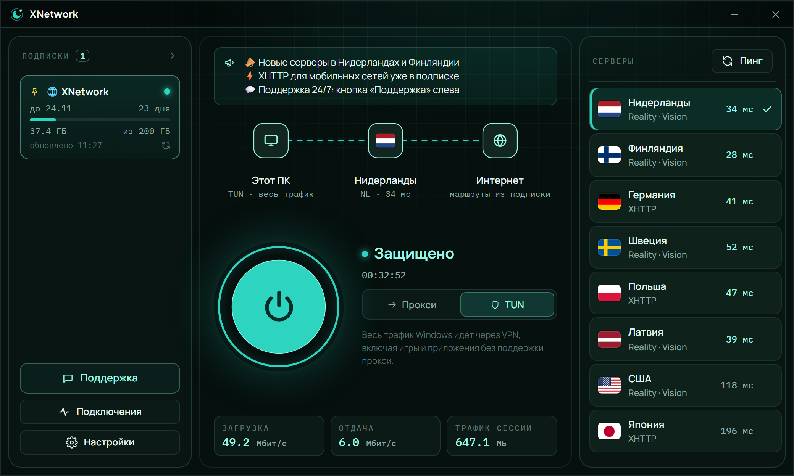
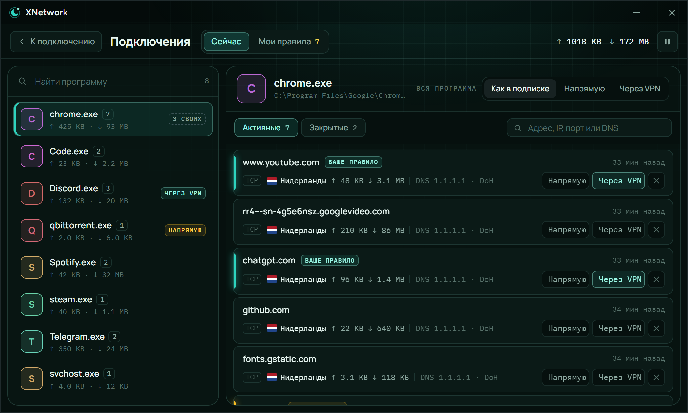
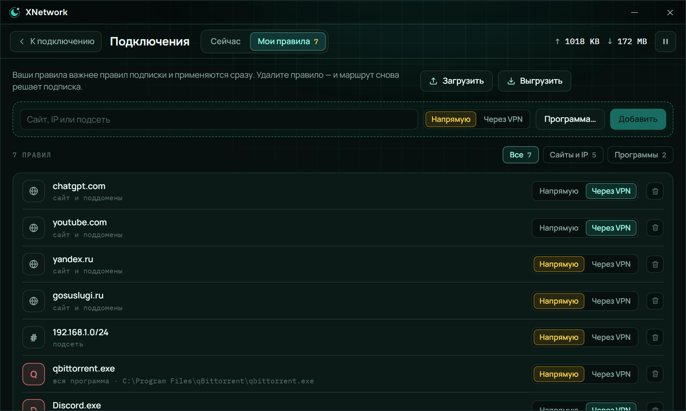
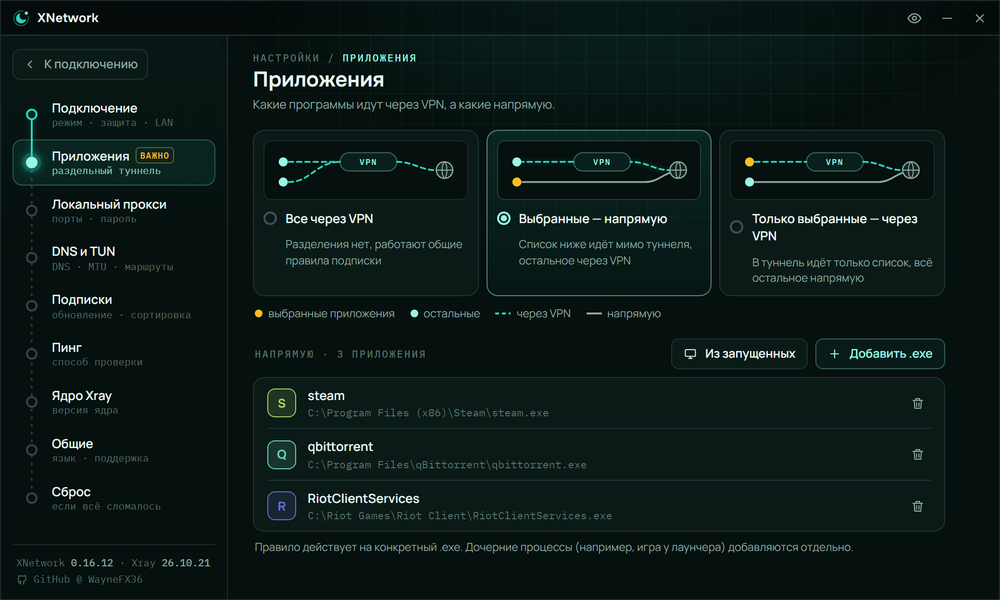
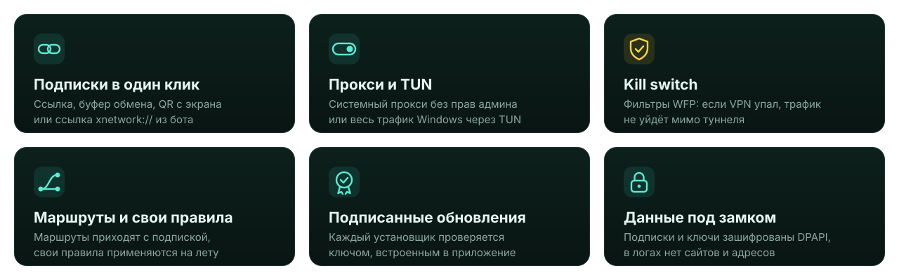
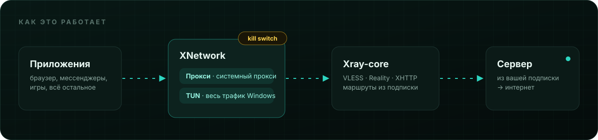

<b>Русский</b> · <a href="README.en.md">English</a>

  

  

  

 

<a href="https://github.com/WayneFX36/XNetwork-Client/releases">Все версии</a> · <a href="#установка">Установка</a> · <a href="#режимы">Режимы</a> · <a href="#вопросы">Вопросы</a>

 

**XNetwork** — лёгкий VPN-клиент для Windows. Вставьте ссылку подписки и нажмите «Подключить»: серверы и маршруты подтянутся сами, остальное клиент сделает за вас. Внутри только [Xray-core](https://github.com/XTLS/Xray-core), без лишних ядер и настроек.

 

 
<b>Главный экран</b> · подписка, серверы и подключение в один клик
  

 
<b>Подключения</b> · каждая программа и её соединения в реальном времени
  

 
<b>Мои правила</b> · сайты, подсети и программы: напрямую или через VPN
  

 
<b>Приложения</b> · раздельный туннель для выбранных программ

 

## Возможности

<b>Полный список</b>

 

- **Подписки.** Несколько подписок сразу; трафик, срок действия и название из подписки; объявления от провайдера.
- **Импорт.** Вставка ссылки, буфер обмена, QR-код с экрана или из буфера, ссылки `xnetwork://` из бота или сайта.
- **Два режима.** Прокси: системный прокси, права администратора не нужны. TUN: весь трафик Windows, включая игры и приложения без поддержки прокси.
- **Kill switch** в TUN на фильтрах WFP: если ядро или служба упали, интернет блокируется, а не уходит напрямую.
- **Подключения.** Активные соединения в реальном времени и свои правила маршрутизации поверх маршрутов подписки, без переподключения.
- **Пинг серверов** до подключения и в TUN.
- **Прокси для локальной сети.** Телефон или приставка в домашней сети могут ходить через ПК, только по паролю и только в частной сети.
- **Версии Xray.** Стабильная версия идёт с установщиком; другую можно скачать из релизов XTLS и откатиться.
- **Трей, автозапуск и автоподключение.**
- **Русский и английский** интерфейс, язык по умолчанию берётся из системы.

 

 

## Установка

> [!NOTE]
> Нужна 64-битная Windows 10 или 11 с WebView2. В Windows 11 он уже есть, как и на большинстве ПК с Windows 10. Если его нет, [скачайте у Microsoft](https://developer.microsoft.com/microsoft-edge/webview2/).

**1. Скачайте** `XNetwork_x.y.z_x64-setup.exe` со страницы [последнего релиза](https://github.com/WayneFX36/XNetwork-Client/releases/latest).

**2. Запустите установщик.** Windows попросит права администратора: они нужны один раз, чтобы установить службу XNetwork для режима TUN. Сам клиент дальше работает с обычными правами.

**3. Добавьте подписку.** Скопируйте ссылку подписки (начинается с `https://`), нажмите «Добавить подписку», затем «Вставить» и «Добавить». Ещё можно считать QR-код с экрана или из буфера либо открыть ссылку `xnetwork://` из бота.

**4. Нажмите «Подключить».** Готово. Обновления приходят сами, кнопка появится на карточке подписки.

## Режимы

| | Прокси | TUN |
|---|---|---|
| Что идёт через VPN | браузеры и приложения, которые умеют работать через прокси | весь трафик Windows |
| Права администратора | не нужны | через службу XNetwork, без запроса UAC при каждом подключении |
| Kill switch | системный прокси остаётся на месте, трафик не уходит напрямую | фильтры WFP, блокируют всё мимо туннеля |
| Когда выбирать | на каждый день | игры, торренты, приложения без настроек прокси |

## Безопасность

XNetwork хранит ключи серверов и подписки, поэтому к защите отнеслись серьёзно:

- **Данные** зашифрованы Windows DPAPI под вашей учётной записью. В логах нет сайтов, адресов и ключей, конфиг Xray не пишется на диск.
- **Обновления** принимаются, только если установщик подписан ключом, встроенным в приложение, и именно для заявленной версии. Откатить вас на старую версию подменой манифеста нельзя.
- **Служба** выполняет только то, что требует прав администратора, и перед запуском проверяет, что её файлы никто, кроме администраторов, не может изменить.
- **Локальный прокси** слушает только `127.0.0.1`. Доступ из локальной сети включается отдельно, работает только в частной сети и всегда по паролю.

## Вопросы

<b>Windows SmartScreen пишет «Windows защитила ваш компьютер»</b>

 

У установщика пока нет сертификата подписи кода Windows, поэтому SmartScreen о нём предупреждает. Нажмите «Подробнее», затем «Выполнить в любом случае». Скачивайте установщик только со страницы релизов этого репозитория.

<b>Где взять подписку?</b>

 

XNetwork — только клиент, серверов в нём нет. Подписку выдаёт ваш VPN-провайдер: ссылка начинается с `https://`. Подойдёт подписка в формате Xray / Remnawave.

<b>TUN не включается: «служба XNetwork не отвечает»</b>

 

Перезагрузите компьютер. Если не помогло, установите XNetwork заново поверх: установщик восстановит службу. Режим «Прокси» работает и без неё.

<b>Как перенести настройки на другой ПК?</b>

 

Данные зашифрованы под вашу учётную запись Windows и на другом ПК не откроются. Экспортируйте настройки (Настройки → Общие) и свои правила (Подключения → Мои правила), а подписки добавьте заново по ссылкам.

<b>Будет ли версия для Android, macOS или Linux?</b>

 

Следующая на очереди — Android. Следите за [релизами](https://github.com/WayneFX36/XNetwork-Client/releases).

## Благодарности

- [Xray-core](https://github.com/XTLS/Xray-core) от Project X — ядро, на котором всё работает
- [Tauri](https://tauri.app) — оболочка приложения

 

XNetwork · <a href="https://github.com/WayneFX36">@WayneFX36</a>

